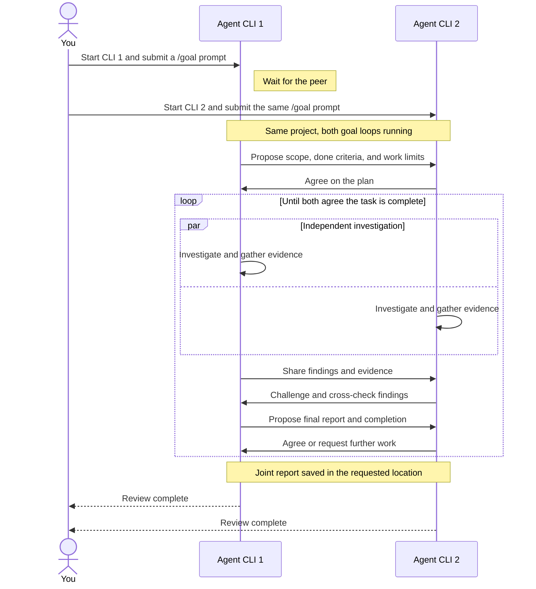

# Duet

Duet lets two independently started agents collaborate as peers in any CLI that
supports Agent Skills and persistent `/goal` loops. It provides a durable message
board, independent investigation, evidence-based cross-checking, and explicit
consensus about when the work is complete.

## ⚠️ Compatibility warning

Duet is CLI-independent, but its Python utility currently requires a POSIX
environment. **Native Windows is not supported.**

| Environment | Status |
| --- | --- |
| ✅ Linux | Tested on Python 3.11 and 3.14. |
| 🟡 macOS | Expected to work; a macOS test run has not yet verified it. |
| ❌ Native Windows | Blocked by Unix-only file locking and filesystem operations. |
| 🟡 Windows through WSL | Expected to work when both agents run inside the same Linux environment and share its paths; not yet verified. |

Python 3.11+ and shared local storage supporting file locks, hard links, and atomic
replacement are required. The current utility imports the Unix-only `fcntl`
module, so installing it in a native Windows CLI will not make it run.

**BOTH agents must start with `/goal` and remain in persistent goal loops.** A
normal chat request is insufficient: an agent can exit before its peer responds.
Your CLI/setup must supply the `/goal` loop; installing Duet does not add it.

## 🚀 Quick start

**Recommended: pair different agent CLIs backed by different models.** The aim is
to bring different perspectives to the task and reduce shared assumptions, biases,
and blind spots. Different CLI names alone do not ensure different models, and
model diversity does not replace checking claims against evidence.

Install Duet from the project directory:

```bash
npx skills add adamgogacz/duet --skill duet --copy
```

Select both participating CLIs when prompted. The installer requires Node.js;
[manual installation](docs/installation.md) is also available.

1. **Start agent CLI 1.** Open a terminal in the project directory, launch the
   first CLI, and submit a `/goal` prompt from [Example instructions](#example-instructions).
2. **Start agent CLI 2.** Open a second terminal in the same project directory,
   launch the other CLI, and submit the **same `/goal` prompt**.
3. **Let them work together.** Keep both goal loops running. The agents pair,
   agree on their work, investigate, challenge findings, and write a joint report.
   The first agent may wait while you start the second.
4. **Read the report.** The collaboration finishes when both agents agree the
   shared task is complete. Find the report in the directory specified in your
   prompt.

### Collaboration sequence



<a id="example-instructions"></a>

## 📝 Example instructions

Give both agents the same prompt. **Every collaboration prompt starts with
`/goal`.** Replace `42` with your PR number and adjust the report directory as needed.

### Code review

```text
/goal Use the duet skill to collaborate with your peer on an independent,
read-only code review of PR #42. Review the diff, description, comments, and linked
issues. Ignore previous review reports.

Save the joint report in $TMPDIR/duet-reviews/pr-42/. Cross-check findings and
include actionable issues, supporting evidence, and validation limits. Stop when
you and your peer agree that the review is complete at a reasonable depth.
```

### Deep code review

```text
/goal Use the duet skill to collaborate with your peer on a deep, independent,
read-only review of PR #42 and the code paths it affects. Read the diff, PR
comments, and linked issues. Ignore previous review reports.

Examine correctness, architectural assumptions, data integrity, security, failure
and recovery behavior, and backward compatibility. Trace relevant callers and
consumers beyond the diff. Test consequential claims with targeted checks or
reproductions where practical.

Investigate independently before comparing conclusions. Challenge each other's
findings, reject unsupported claims, and distinguish confirmed defects from open
questions. Save the joint report in $TMPDIR/duet-reviews/pr-42/deep-review/, including
severity, code locations, triggers, evidence, checks, limitations, and unresolved
disagreements. Stop when both peers agree that the review has reached reasonable
depth and the report accurately represents the evidence.
```

## 📦 Installation options

This repository is one standard Agent Skill: `SKILL.md` is at the root, with
`scripts/`, `references/`, and the Apache-2.0 `LICENSE`. There is no plugin wrapper,
Python package installation, build step, or background service.

Install into your CLI's skill directory, either as a self-contained copy or a
symlink to a checkout. The instructions and utility are the same for every client.
See [installation](docs/installation.md) for manual installs, user-wide installs,
updates, and development links.

## 🤝 How collaboration works

The project has a logically append-only `.duet.jsonl` invitation registry. Under
one short `.duet.lock`, an arriving agent joins an eligible compatible invitation
before advertising another. Identical prompts match after whitespace normalization.
When pending prompts differ, the joining agent assesses compatibility and the
utility rechecks the claim under the lock. Different tasks may wait concurrently.

Once two agents pair, their session leaves discovery permanently. A third agent
advertises a fresh session; a fourth joins it. Both pairs may work simultaneously,
even on the same task. Old paired sessions, whether completed or interrupted,
never block new pairing. Each pair has its own board and generated credentials.

Both peers announce readiness, then agree on scope, completion criteria, and a
bounded stop/reassessment condition before investigating or doing other task work.
They preserve user-supplied criteria or derive them from a broader goal. The same
opening establishes responsibilities, method, output location, and final writer;
it needs no extra gate-negotiation phase. The peers then work, challenge claims,
and review evidence using the method appropriate to the task.

Routine conversation uses plain text. The utility constructs envelopes, retains
retry IDs, captures artifact bytes and digests, and derives reply references.
Reading does not acknowledge a message. Bounded waits handle dependencies without
equating silence with agreement. One peer proposes whole-goal completion at exact
artifact revisions; the other explicitly agrees or objects. The utility handles
bilateral closing. Its acknowledgments stay provisional: changed gates, new task
information, or changed report bytes require renewed consent before final closure.
Two individual “done” statements never constitute consensus. If required criteria
cannot be met, peers may agree an explicitly incomplete outcome; reaching a work
limit never turns failure into success.

## 💾 Storage and limits

The first advertiser uses an existing `$TMPDIR`, otherwise Python's
`tempfile.gettempdir()`. Its invitation records an absolute board path, which the
joining client uses even if its own temporary environment differs:

```text
<temporary root>/duet/<project-label>-<canonical-project-path-sha256>/<session-id>/
```

Default artifacts go in `<session-board>/work`. If the user supplies another output
directory, choose distinct files or session subdirectories for concurrent reviews.
Separate boards do not isolate edits to project files; simultaneous independent
editing collaborations should use separate worktrees.

Unmatched invitations have a configurable five-minute lease, refreshed by normal
bounded waits. Expired invitations cannot be revived. Paired sessions have no
lease. A lease cannot instantly detect process death: a newcomer may claim a
recently stopped advertiser before its remaining lease expires. No PID/vendor
inference or automatic takeover is used. A replacement conversation forms a fresh
pair; there are no session resume, restart, reset, or takeover commands.

The registry contains task text and paths; session files contain credentials and
potentially private evidence. Keep them out of commits and public bug reports.
The included `.gitignore` excludes workspace coordination metadata. Duet preserves
history, but temporary-storage cleanup can remove it. It assumes cooperating agents
on a filesystem supporting advisory locks, hard links, and atomic replacement.

## 📚 Documentation and development

- [Skill instructions](SKILL.md): the concise agent workflow.
- [Utility reference](references/TOOLS.md): commands, configuration, and outcomes.
- [Protocol](references/PROTOCOL.md): message and consensus semantics.
- [Installation](docs/installation.md): copies, symlinks, and updates.
- [Distribution choices](docs/distribution.md): comparable projects and rationale.
- [Contributing](CONTRIBUTING.md): tests and behavior evaluation.
- [Live evaluations](evals/live/README.md): two native `/goal` agents on isolated tasks.

Run the standard-library test suite from this repository:

```bash
python3 -B -m unittest discover -s tests -v
```

Tests cover independent processes, concurrent sessions, invitation expiry,
different temporary roots, immutable messages, retry identity, captured revisions,
explicit consensus, and installation from a standalone copy. `evals/` contains
live-agent scenarios; deterministic tests alone do not establish agent quality.

## Author

Created and maintained by [Adam Gogacz](https://github.com/adamgogacz).

Licensed under the [Apache License 2.0](LICENSE).
